# Dashboard Anime 
**Tugas Perkuliahan: BAB 9 - NestJS Dasar + Struktur MVC**

Aplikasi manajemen katalog anime berbasis arsitektur **MVC (Model-View-Controller)** dengan backend **NestJS** dan frontend **React + Vite**. Aplikasi ini mengelola data anime secara dinamis dengan fitur CRUD (Create, Read, Update, Delete), validasi data menggunakan DTO, penanganan exception, dan integrasi frontend-backend secara real-time.

---

## Daftar Endpoint API (RESTful)

| Method | Endpoint | Deskripsi | HTTP Status |
|:---|:---|:---|:---|
| **GET** | `/anime` | Mengambil seluruh koleksi data anime | `200 OK` |
| **GET** | `/anime/:id` | Mengambil detail 1 anime berdasarkan ID | `200 OK` / `404 Not Found` |
| **POST** | `/anime` | Menambahkan data anime baru | `201 Created` / `400` / `409` |
| **PATCH** | `/anime/:id` | Memperbarui sebagian properti anime | `200 OK` / `404 Not Found` |
| **DELETE** | `/anime/:id` | Menghapus anime berdasarkan ID | `200 OK` / `404 Not Found` |
| **POST** | `/anime/reset` | Memulihkan data sampel awal | `201 Created` |

---

## Pengujian Endpoint & Aplikasi

Berikut adalah dokumentasi hasil pengujian setiap tahapan. Seluruh gambar tersimpan pada folder `docs/screenshots/`:

### A. Backend 

#### 1. GET /anime (Ambil Semua Data)
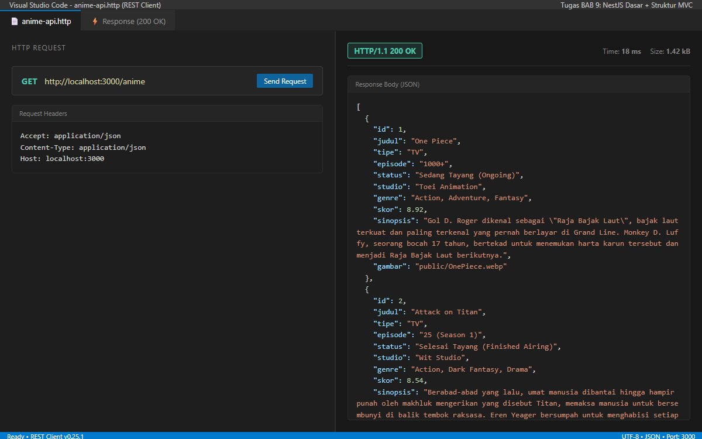

#### 2. GET /anime/:id (Detail Anime)
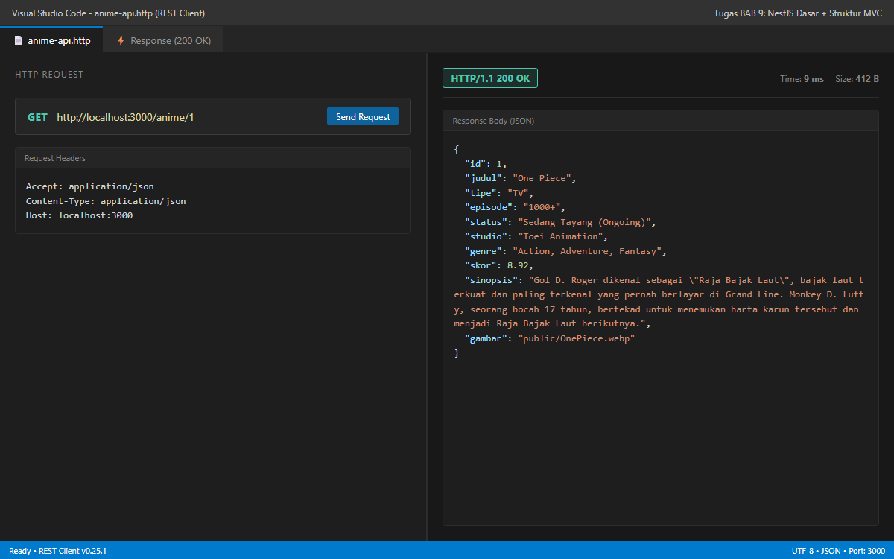

#### 3. GET /anime/:id (Data Tidak Ditemukan)
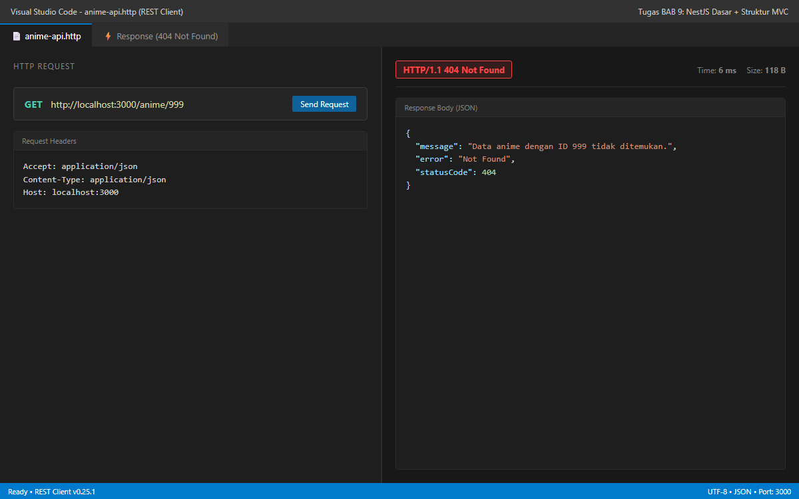

#### 4. POST /anime (Tambah Anime)
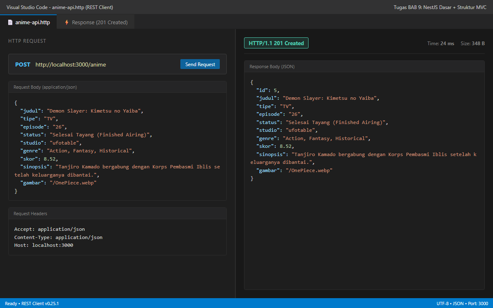

#### 5. POST /anime (Judul Duplikat)
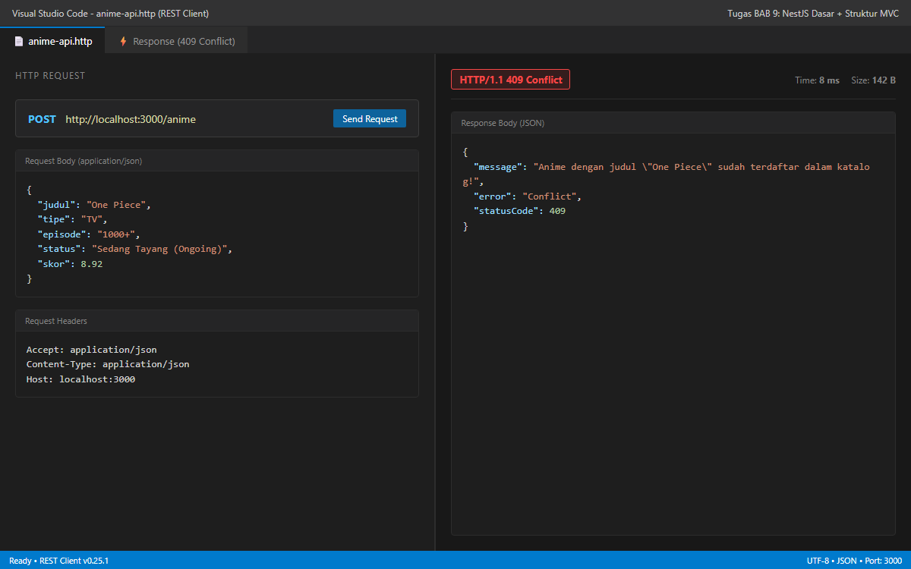

#### 6. POST /anime (Validasi Input)
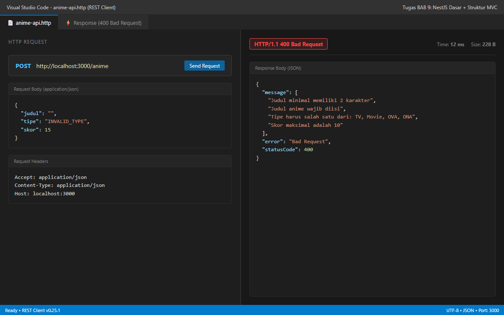

#### 7. PATCH /anime/:id (Update Anime)
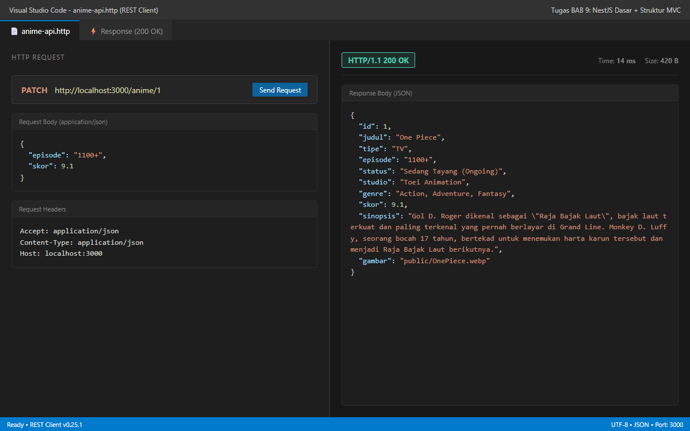

#### 8. DELETE /anime/:id (Hapus Anime)
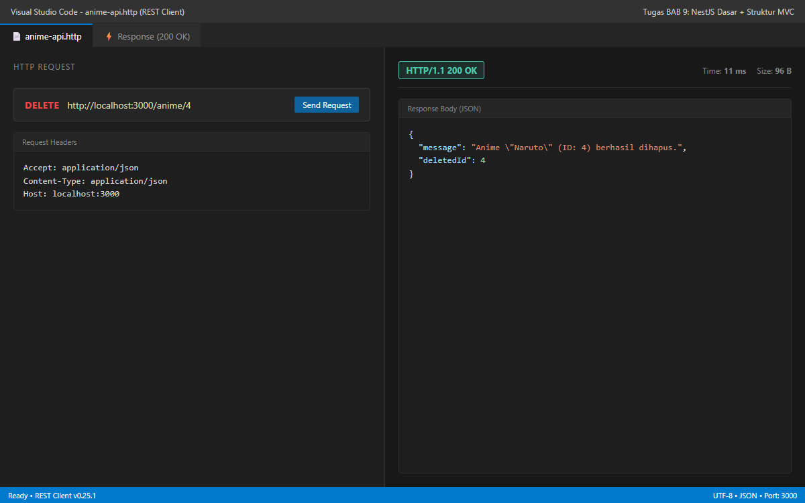

### B. Tampilan Aplikasi

#### 9. Tampilan Dashboard Utama
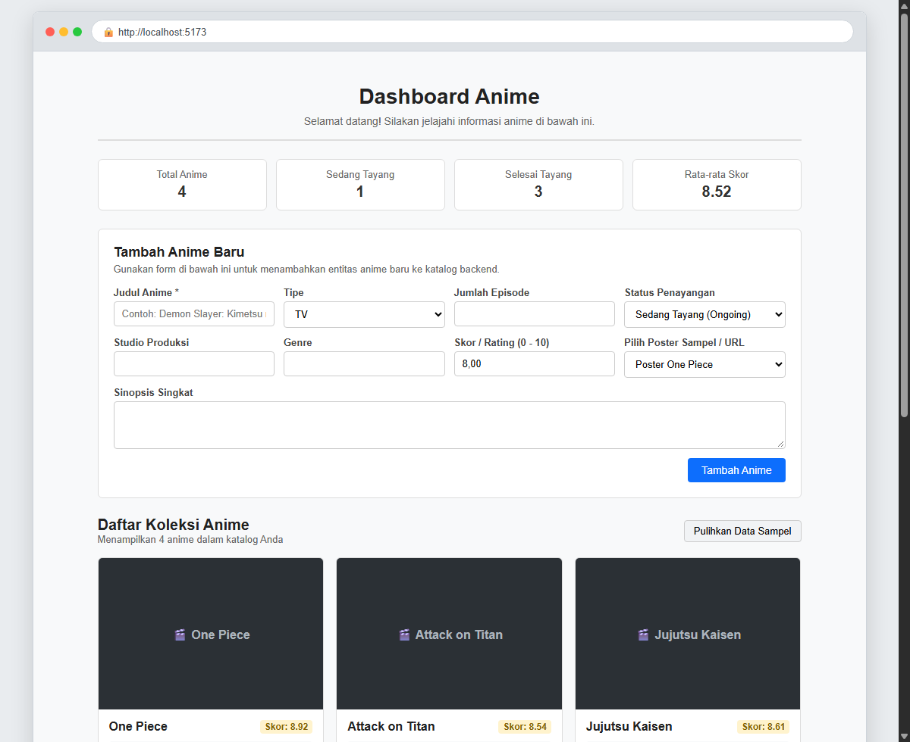

#### 10. Tampilan Form Tambah Anime
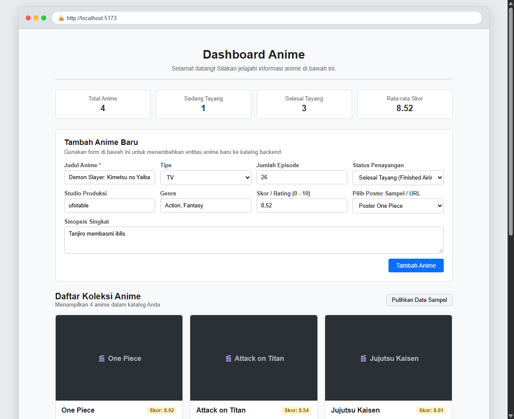

#### 11. Tampilan Form Edit Anime
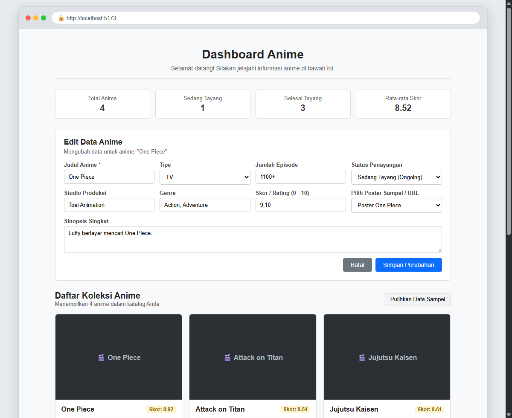

#### 12. Tampilan Setelah Hapus Anime
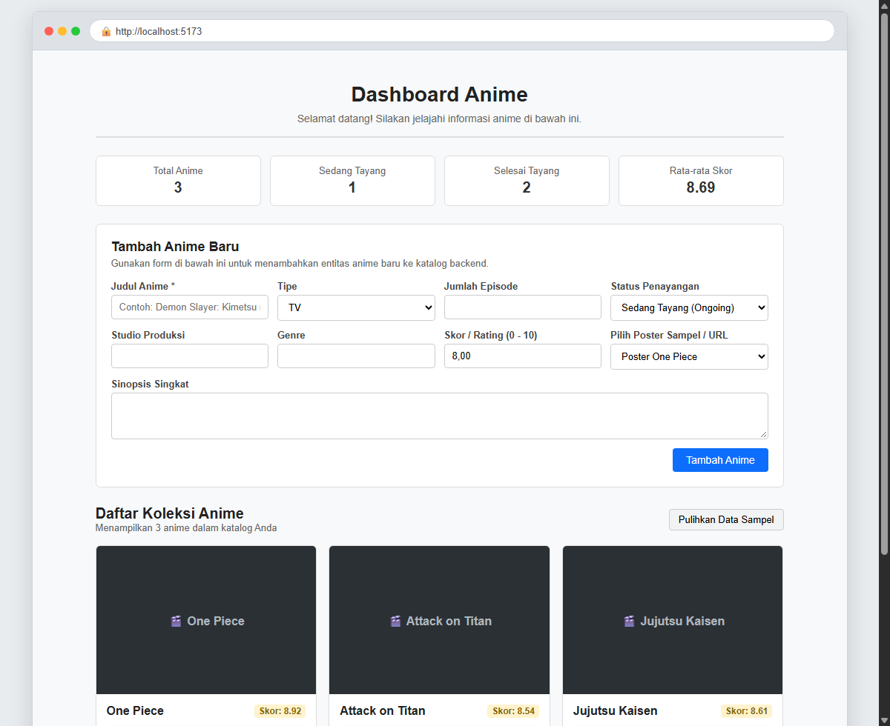
